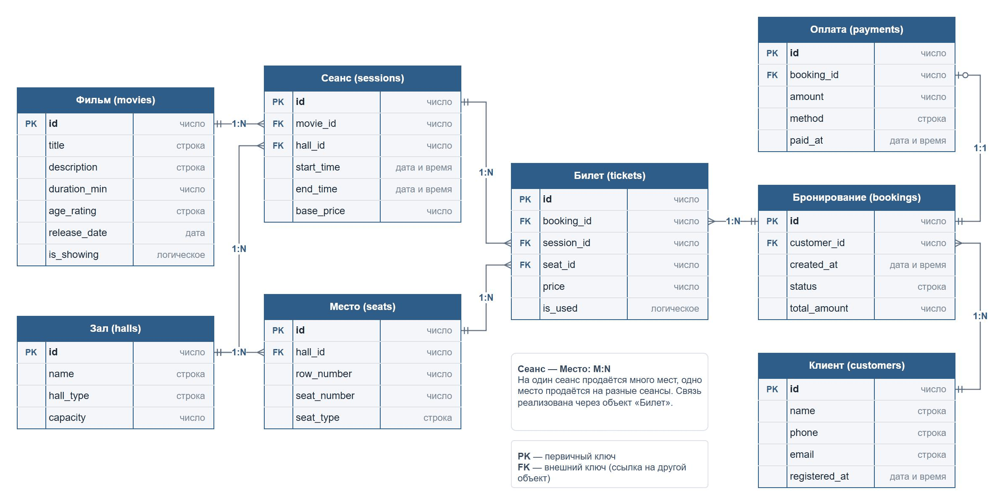

# Анализ и моделирование данных предметной области

**Вариант:** 7, кинотеатр

## 1. Описание предметной области

**Предметная область:** кинотеатр — организация кинопоказов и продажа билетов.

**Назначение:** информационная система кинотеатра хранит данные о фильмах, залах и расписании сеансов, показывает свободные места и позволяет забронировать и купить билет на выбранное место.

**Основные пользователи:**

- зрители (клиенты) — смотрят расписание, выбирают места, бронируют и покупают билеты;
- администратор кинотеатра — ведёт каталог фильмов, залы и расписание сеансов;
- кассир — продаёт билеты в кассе и оформляет оплату;
- контролёр — проверяет билеты на входе в зал.

**Основные процессы:**

- ведение информации о фильмах;
- ведение информации о залах и схеме мест в каждом зале;
- формирование расписания сеансов;
- выбор мест на сеанс;
- бронирование билетов;
- оплата и продажа билетов;
- проверка билета на входе в зал.

**Основные задачи информационной системы:**

- хранить каталог фильмов и их характеристики;
- хранить залы и расположение мест в них;
- хранить расписание сеансов: какой фильм, в каком зале и в какое время;
- показывать, какие места на сеанс свободны, а какие уже заняты;
- не допускать продажи одного места на один сеанс дважды;
- хранить бронирования клиентов и информацию об оплате;
- отмечать использованные билеты.

## 2. Объекты данных

### Объект 1. Фильм

**Назначение:** фильм, который кинотеатр показывает или планирует показывать.

**Какая информация должна храниться:** название, описание, продолжительность, возрастное ограничение, дата выхода в прокат, признак того, что фильм сейчас в прокате.

### Объект 2. Зал

**Назначение:** кинозал, в котором проходят сеансы.

**Какая информация должна храниться:** название или номер зала, тип зала (2D, 3D, IMAX), вместимость.

### Объект 3. Место

**Назначение:** конкретное кресло в зале, которое зритель выбирает при покупке билета.

**Какая информация должна храниться:** зал, в котором находится место, номер ряда, номер места, тип места (стандартное, VIP, диван).

### Объект 4. Сеанс

**Назначение:** показ конкретного фильма в конкретном зале в определённое время. Из сеансов складывается расписание.

**Какая информация должна храниться:** фильм, зал, время начала, время окончания, базовая цена билета.

### Объект 5. Клиент

**Назначение:** зритель, который бронирует и покупает билеты.

**Какая информация должна храниться:** имя, телефон, email, дата регистрации.

### Объект 6. Бронирование

**Назначение:** заказ клиента, в который входят один или несколько билетов (например, когда зрители идут компанией).

**Какая информация должна храниться:** клиент, дата и время создания, статус (создано, оплачено, отменено), итоговая стоимость.

### Объект 7. Билет

**Назначение:** право посетить конкретный сеанс на конкретном месте.

**Какая информация должна храниться:** бронирование, сеанс, место, цена, признак того, что билет уже использован на входе.

### Объект 8. Оплата

**Назначение:** факт оплаты бронирования.

**Какая информация должна храниться:** бронирование, сумма, способ оплаты, дата и время оплаты.

### Участие объектов в процессах

| Процесс | Объекты |
|---|---|
| Ведение информации о фильмах | Фильм |
| Ведение залов и схемы мест | Зал, Место |
| Формирование расписания | Сеанс, Фильм, Зал |
| Выбор мест | Сеанс, Место, Билет |
| Бронирование | Клиент, Бронирование, Билет |
| Оплата и продажа | Бронирование, Оплата |
| Проверка билета на входе | Билет |

Каждый объект участвует хотя бы в одном основном процессе, лишних объектов нет.

## 3. Атрибуты объектов

Для каждого объекта определены основные атрибуты и предполагаемые типы данных. Названия атрибутов даны латиницей, как они могли бы называться в будущей базе данных.

### Фильм (movies)

| Атрибут | Тип данных | Описание |
|---|---|---|
| id | Число | Уникальный идентификатор фильма |
| title | Строка | Название фильма |
| description | Строка | Краткое описание сюжета |
| duration_min | Число | Продолжительность в минутах |
| age_rating | Строка | Возрастное ограничение (0+, 6+, 12+, 16+, 18+) |
| release_date | Дата | Дата выхода в прокат |
| is_showing | Логическое | Идёт ли фильм в прокате сейчас |

### Зал (halls)

| Атрибут | Тип данных | Описание |
|---|---|---|
| id | Число | Уникальный идентификатор зала |
| name | Строка | Название или номер зала |
| hall_type | Строка | Тип зала (2D, 3D, IMAX) |
| capacity | Число | Количество мест в зале |

### Место (seats)

| Атрибут | Тип данных | Описание |
|---|---|---|
| id | Число | Уникальный идентификатор места |
| hall_id | Число | Идентификатор зала, в котором находится место |
| row_number | Число | Номер ряда |
| seat_number | Число | Номер места в ряду |
| seat_type | Строка | Тип места (стандартное, VIP, диван) |

### Сеанс (sessions)

| Атрибут | Тип данных | Описание |
|---|---|---|
| id | Число | Уникальный идентификатор сеанса |
| movie_id | Число | Идентификатор фильма |
| hall_id | Число | Идентификатор зала |
| start_time | Дата и время | Начало сеанса |
| end_time | Дата и время | Окончание сеанса |
| base_price | Число | Базовая цена билета на сеанс |

### Клиент (customers)

| Атрибут | Тип данных | Описание |
|---|---|---|
| id | Число | Уникальный идентификатор клиента |
| name | Строка | Имя клиента |
| phone | Строка | Номер телефона |
| email | Строка | Адрес электронной почты для отправки билетов |
| registered_at | Дата и время | Дата и время регистрации |

### Бронирование (bookings)

| Атрибут | Тип данных | Описание |
|---|---|---|
| id | Число | Уникальный идентификатор бронирования |
| customer_id | Число | Идентификатор клиента |
| created_at | Дата и время | Когда создано бронирование |
| status | Строка | Статус: создано, оплачено, отменено |
| total_amount | Число | Итоговая стоимость бронирования |

### Билет (tickets)

| Атрибут | Тип данных | Описание |
|---|---|---|
| id | Число | Уникальный идентификатор билета |
| booking_id | Число | Идентификатор бронирования |
| session_id | Число | Идентификатор сеанса |
| seat_id | Число | Идентификатор места |
| price | Число | Цена билета на момент продажи |
| is_used | Логическое | Был ли билет использован на входе |

### Оплата (payments)

| Атрибут | Тип данных | Описание |
|---|---|---|
| id | Число | Уникальный идентификатор оплаты |
| booking_id | Число | Идентификатор оплаченного бронирования |
| amount | Число | Сумма оплаты |
| method | Строка | Способ оплаты: банковская карта, СБП, наличные |
| paid_at | Дата и время | Дата и время оплаты |

Номер телефона хранится строкой, а не числом: в нём есть знак «+», а арифметические операции с ним не нужны.

## 4. Классификация данных

Все атрибуты модели распределены по категориям. Каждый атрибут относится к одной категории.

| Категория данных | Атрибуты | Назначение |
|---|---|---|
| Текстовые | название и описание фильма, название зала, имя, телефон и email клиента | Названия, описания и контактные данные |
| Числовые | все идентификаторы (`id` и `*_id`), продолжительность фильма, номер ряда и места, базовая цена сеанса, цена билета, сумма оплаты | Идентификация записей, количества и денежные суммы |
| Даты и время | дата выхода фильма, начало сеанса, время создания бронирования, время оплаты, дата регистрации клиента | Даты событий; по ним строится расписание и ищутся записи за период |
| Логические | фильм в прокате (is_showing), билет использован (is_used) | Признаки «да / нет» |
| Справочные | возрастное ограничение, тип зала, тип места, статус бронирования, способ оплаты | Значения из заранее определённого набора |
| Вычисляемые | окончание сеанса, вместимость зала, итоговая стоимость бронирования | Значения, которые можно получить из других данных |

### Справочные данные

| Атрибут | Допустимые значения |
|---|---|
| Фильм.age_rating | 0+, 6+, 12+, 16+, 18+ |
| Зал.hall_type | 2D, 3D, IMAX |
| Место.seat_type | стандартное, VIP, диван |
| Бронирование.status | создано, оплачено, отменено |
| Оплата.method | банковская карта, СБП, наличные |

Если хранить такие значения свободным текстом, появятся разные варианты написания одного и того же («VIP», «вип», «Vip»). Поэтому значения выбираются только из справочника.

### Вычисляемые данные

| Атрибут | Как вычисляется |
|---|---|
| Сеанс.end_time | start_time + продолжительность фильма (duration_min) |
| Зал.capacity | количество записей «Место» с этим hall_id |
| Бронирование.total_amount | сумма цен (price) всех билетов бронирования |

Цена билета (price) рассчитывается при продаже из базовой цены сеанса и типа места, но после продажи хранится как отдельное значение. Если позже изменится цена сеанса, цена уже проданного билета должна остаться прежней.

## 5. Связи между объектами

### Связь 1. Фильм — Сеанс

**Тип связи:** один ко многим (1:N).

Один фильм показывается на многих сеансах. Каждый сеанс — показ одного фильма.

### Связь 2. Зал — Сеанс

**Тип связи:** один ко многим (1:N).

В одном зале в течение дня проходит много сеансов. Каждый сеанс проходит в одном зале.

### Связь 3. Зал — Место

**Тип связи:** один ко многим (1:N).

В зале много мест. Каждое место находится в одном зале.

### Связь 4. Клиент — Бронирование

**Тип связи:** один ко многим (1:N).

Клиент может сделать много бронирований. Каждое бронирование принадлежит одному клиенту.

### Связь 5. Бронирование — Билет

**Тип связи:** один ко многим (1:N).

В одно бронирование может входить несколько билетов. Каждый билет относится к одному бронированию.

### Связь 6. Сеанс — Билет

**Тип связи:** один ко многим (1:N).

На один сеанс продаётся много билетов. Каждый билет действует на один сеанс.

### Связь 7. Место — Билет

**Тип связи:** один ко многим (1:N).

Одно и то же место продаётся на разные сеансы. Каждый билет даёт право на одно место.

### Связь 8. Бронирование — Оплата

**Тип связи:** один к одному (1:1).

Бронирование оплачивается один раз, и одна оплата относится к одному бронированию. Пока бронирование не оплачено, оплаты у него нет, поэтому на схеме со стороны оплаты указано «ноль или один».

### Связь 9. Сеанс — Место

**Тип связи:** многие ко многим (M:N).

На одном сеансе занято много мест, и одно место используется на многих сеансах. Эта связь реализована через объект «Билет»: в каждом билете хранятся идентификаторы сеанса и места. Пара «сеанс + место» должна быть уникальной, иначе одно место на один сеанс можно продать дважды.

Все основные процессы отражены связями: расписание — связи 1 и 2, схема зала — связь 3, выбор мест — связи 6, 7 и 9, бронирование — связи 4 и 5, оплата — связь 8.

## 6. Концептуальная модель данных

Модель построена в виде ER-диаграммы в draw.io. Для каждого объекта указаны атрибуты с типами данных, PK — первичный ключ, FK — внешний ключ.

Исходный файл диаграммы: [conceptual_model.drawio](../diagrams/conceptual_model.drawio)

На схеме отражены связи:

- Фильм 1:N Сеанс;
- Зал 1:N Сеанс;
- Зал 1:N Место;
- Клиент 1:N Бронирование;
- Бронирование 1:N Билет;
- Сеанс 1:N Билет;
- Место 1:N Билет;
- Бронирование 1:1 Оплата;
- Сеанс M:N Место (через Билет).

## 7. Оценка качества исходных данных

**1. Достаточно ли объектов выделено?**

Да. Восемь объектов покрывают все процессы из варианта: фильмы и залы, расписание сеансов, выбор мест, бронирование и продажу билетов (таблица в разделе 2).

При проверке выяснилось, что в первом варианте модели не было объекта «Оплата»: факт оплаты хранился только статусом бронирования, и нельзя было узнать, когда и каким способом заплатили. Оплата выделена в отдельный объект со связью 1:1 с бронированием.

**2. Отсутствуют ли важные сущности?**

Для основных процессов сущностей достаточно. При развитии системы можно добавить:

- жанры фильмов: у фильма может быть несколько жанров, поэтому понадобится справочник «Жанр» со связью M:N с фильмом;
- сотрудников (кассиров, администраторов), чтобы знать, кто продал билет;
- скидки и акции, например детский или студенческий билет;
- возвраты билетов.

Отдельно стоит отметить покупку в кассе без регистрации: сейчас каждое бронирование обязательно связано с клиентом, поэтому для анонимной покупки придётся разрешить бронирование без клиента или заводить «гостевого» клиента.

**3. Все ли необходимые атрибуты определены?**

Да, для концептуальной модели основных атрибутов достаточно. При проверке была найдена проблема с ценой: сначала цена хранилась только у сеанса (base_price). Но VIP-места и диваны стоят дороже, а цена сеанса может измениться уже после продажи. Поэтому в «Билет» добавлен атрибут price — фактическая цена конкретного билета на момент продажи.

**4. Имеются ли дублирующиеся данные?**

Найдено и исправлено одно дублирование: вместимость зала (capacity) сначала планировалось вводить вручную, но это число уже определяется количеством мест зала в объекте «Место». Два источника одного значения могут разойтись, поэтому capacity отнесена к вычисляемым данным.

Остальные данные не дублируются. Сумма оплаты (amount) и итоговая стоимость бронирования (total_amount) похожи, но это разные сведения: первая фиксирует, сколько фактически заплатили, вторая вычисляется по билетам. Данные о фильме, зале и клиенте хранятся по одному разу, а остальные объекты ссылаются на них через идентификаторы.

**5. Достаточно ли информации для дальнейшего проектирования информационной системы?**

Да. Определены объекты, их атрибуты, типы данных, ключи и связи, выделены справочные и вычисляемые данные. Модель можно использовать для проектирования базы данных: на следующем этапе останется выбрать конкретные типы СУБД и задать ограничения, например уникальность пары «сеанс + место» в билете.

**Вывод:**

Модель полно описывает основную работу кинотеатра. По итогам проверки в неё внесены три изменения: добавлен объект «Оплата», у билета появилась собственная цена, а вместимость зала стала вычисляемым значением.

## Вывод

В ходе лабораторной работы проанализирована предметная область кинотеатра: описаны пользователи, процессы и задачи информационной системы. Выделены восемь объектов данных, для каждого определены атрибуты и их типы, выполнена классификация данных с выделением справочных и вычисляемых значений.

Между объектами определены связи один ко многим, один к одному и многие ко многим. Связь «многие ко многим» между сеансом и местом реализована через объект «Билет». На основе анализа построена концептуальная модель данных в виде ER-диаграммы.

Проверка качества модели показала, что её можно использовать как основу для дальнейшего проектирования базы данных кинотеатра.
