# Лабораторная работа №4

## Анализ данных с помощью SQL

**Вариант:** 7

**Цель работы:** научиться читать структуру базы данных, получать данные с помощью SQL и проверять результаты запросов.

Запросы выполнены в SandboxSQL на учебной базе dataset.sqlite. Результаты дополнительно сверены с локальной копией SQLite. Скриншоты получены при выполнении запросов 5 ноября 2026 года.

Для работы использована база данных учебной организации. В ней хранятся группы, студенты, преподаватели, курсы, записи на курсы и результаты обучения.

## 1. Структура базы данных и первые строки

| Таблица | Столбцы и типы | Первичный ключ | Внешние ключи |
| --- | --- | --- | --- |
| groups | id (INTEGER), group_name (TEXT), study_year (INTEGER) | id | — |
| students | id (INTEGER), full_name (TEXT), group_id (INTEGER), admission_year (INTEGER) | id | group_id → groups.id |
| teachers | id (INTEGER), full_name (TEXT), department (TEXT) | id | — |
| courses | id (INTEGER), course_name (TEXT), hours (INTEGER), teacher_id (INTEGER) | id | teacher_id → teachers.id |
| enrollments | id (INTEGER), student_id (INTEGER), course_id (INTEGER), enrolled_at (TEXT), status (TEXT) | id | course_id → courses.id, student_id → students.id |
| results | id (INTEGER), enrollment_id (INTEGER), score (INTEGER), completed_at (TEXT) | id | enrollment_id → enrollments.id |

### Структура таблицы enrollments

```sql
PRAGMA table_info(enrollments);
```

Команда SQLite показывает столбцы, их типы и отметку первичного ключа. Для `enrollments` получено пять строк.

| cid | name | type | notnull | dflt_value | pk |
| --- | --- | --- | --- | --- | --- |
| 0 | id | INTEGER | 0 | NULL | 1 |
| 1 | student_id | INTEGER | 1 | NULL | 0 |
| 2 | course_id | INTEGER | 1 | NULL | 0 |
| 3 | enrolled_at | TEXT | 1 | NULL | 0 |
| 4 | status | TEXT | 1 | NULL | 0 |

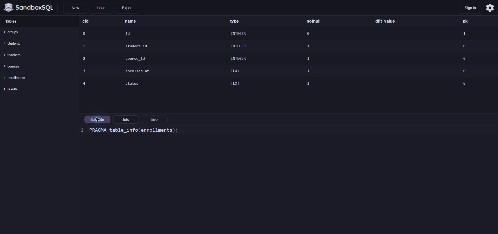

### Число строк в таблицах

```sql
SELECT 'groups' AS table_name, COUNT(*) AS row_count FROM "groups"
UNION ALL SELECT 'students', COUNT(*) FROM students
UNION ALL SELECT 'teachers', COUNT(*) FROM teachers
UNION ALL SELECT 'courses', COUNT(*) FROM courses
UNION ALL SELECT 'enrollments', COUNT(*) FROM enrollments
UNION ALL SELECT 'results', COUNT(*) FROM results;
```

Функция `COUNT(*)` считает строки отдельно в каждой таблице. `UNION ALL` собирает шесть подсчётов в одну выдачу.

| table_name | row_count |
| --- | --- |
| groups | 12 |
| students | 240 |
| teachers | 15 |
| courses | 30 |
| enrollments | 1000 |
| results | 850 |

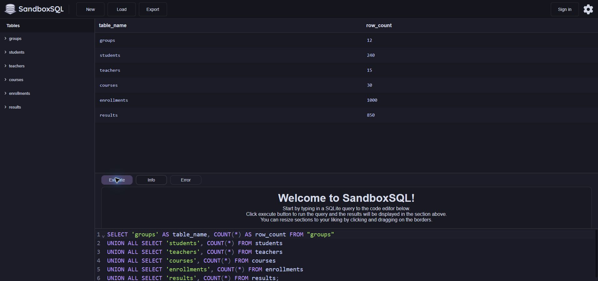

### Первые пять строк таблицы groups

```sql
SELECT * FROM "groups" ORDER BY id LIMIT 5;
```

Сортировка по `id` и `LIMIT 5` дают первые пять групп. Среди них представлены все четыре курса обучения.

| id | group_name | study_year |
| --- | --- | --- |
| 1 | ИВТ-01 | 1 |
| 2 | ИВТ-02 | 2 |
| 3 | ИВТ-03 | 3 |
| 4 | ИВТ-04 | 4 |
| 5 | ИВТ-05 | 1 |

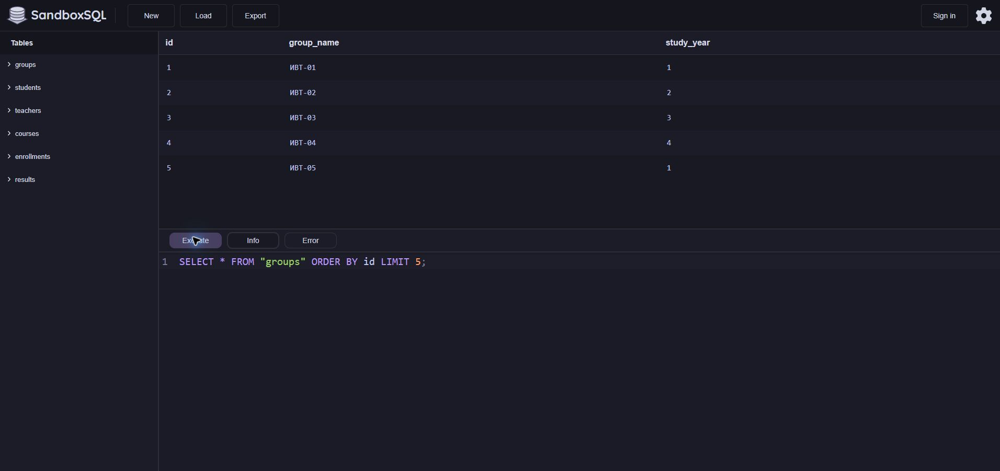

### Первые пять строк таблицы students

```sql
SELECT * FROM students ORDER BY id LIMIT 5;
```

Сортировка по `id` даёт первые пять студентов. У них заполнены группа и год поступления.

| id | full_name | group_id | admission_year |
| --- | --- | --- | --- |
| 1 | Иванов Александр | 1 | 2022 |
| 2 | Иванов Мария | 2 | 2023 |
| 3 | Иванов Иван | 3 | 2024 |
| 4 | Иванов Анна | 4 | 2025 |
| 5 | Иванов Дмитрий | 5 | 2022 |

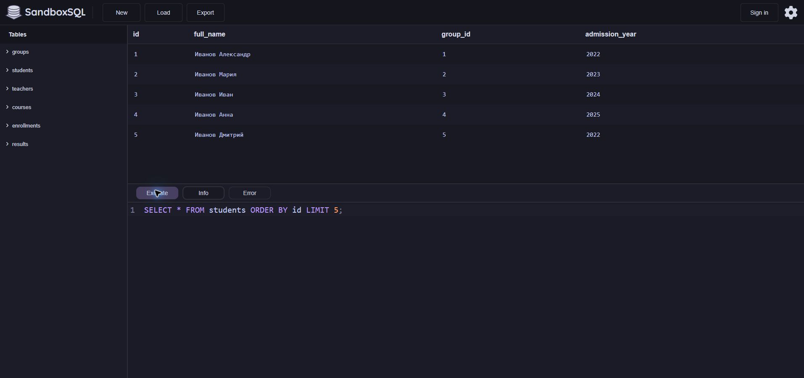

### Первые пять строк таблицы teachers

```sql
SELECT * FROM teachers ORDER BY id LIMIT 5;
```

По идентификатору выбраны первые пять преподавателей. В выборке есть сотрудники трёх кафедр.

| id | full_name | department |
| --- | --- | --- |
| 1 | Преподаватель 01 | Математика |
| 2 | Преподаватель 02 | Аналитика |
| 3 | Преподаватель 03 | Информатика |
| 4 | Преподаватель 04 | Математика |
| 5 | Преподаватель 05 | Аналитика |

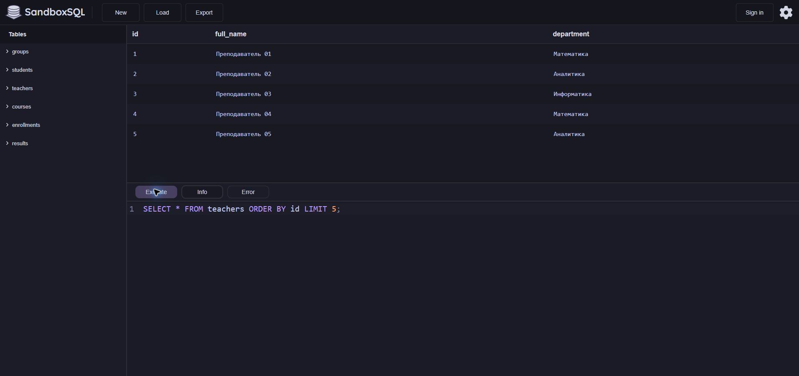

### Первые пять строк таблицы courses

```sql
SELECT * FROM courses ORDER BY id LIMIT 5;
```

В первых пяти строках видны название, часы и ключ преподавателя. Продолжительность этих курсов составляет от 36 до 84 часов.

| id | course_name | hours | teacher_id |
| --- | --- | --- | --- |
| 1 | Основы программирования | 36 | 1 |
| 2 | Базы данных | 48 | 2 |
| 3 | Веб-разработка | 60 | 3 |
| 4 | Алгоритмы | 72 | 4 |
| 5 | Компьютерные сети | 84 | 5 |

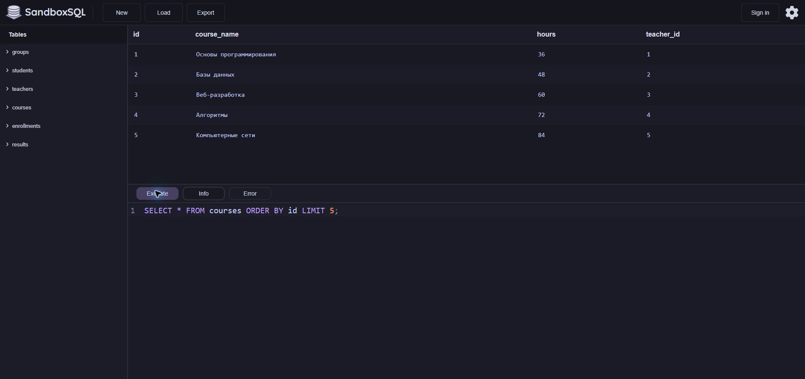

### Первые пять строк таблицы enrollments

```sql
SELECT * FROM enrollments ORDER BY id LIMIT 5;
```

Первые пять записей отсортированы по идентификатору. У всех пяти статус `completed`.

| id | student_id | course_id | enrolled_at | status |
| --- | --- | --- | --- | --- |
| 1 | 1 | 10 | 2026-09-02 | completed |
| 2 | 1 | 19 | 2026-09-03 | completed |
| 3 | 2 | 1 | 2026-09-04 | completed |
| 4 | 2 | 14 | 2026-09-05 | completed |
| 5 | 2 | 17 | 2026-09-06 | completed |

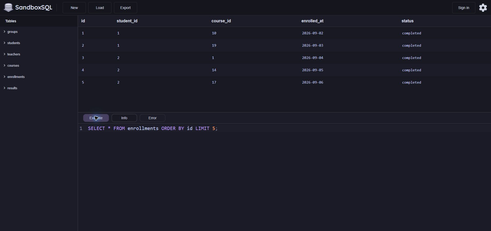

### Первые пять строк таблицы results

```sql
SELECT * FROM results ORDER BY id LIMIT 5;
```

Показаны первые пять результатов с баллами от 73 до 93. Столбец `enrollment_id` указывает на запись на курс.

| id | enrollment_id | score | completed_at |
| --- | --- | --- | --- |
| 1 | 1 | 73 | 2026-10-02 |
| 2 | 2 | 73 | 2026-10-03 |
| 3 | 3 | 76 | 2026-10-04 |
| 4 | 4 | 93 | 2026-10-05 |
| 5 | 5 | 77 | 2026-10-06 |

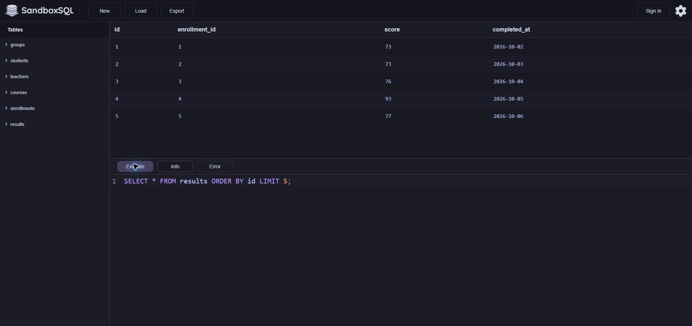

## 2. Вопросы к данным

1. На какие курсы никто не записывался? Кто назначен их преподавателями? Таблицы `courses`, `enrollments`, `teachers`. Показатель — ноль записей по курсу и имя преподавателя.
2. Какие курсы рассчитаны на 60 часов и более? Таблица `courses`. Показатель — продолжительность от 60 часов.
3. Кто входит в первые десять по ФИО среди студентов, поступивших в 2025 году? Таблица `students`. Показатель — год поступления 2025 и место в порядке ФИО.
4. Какие статусы записей встречаются более 100 раз? Таблица `enrollments`. Показатель — число записей по статусу.
5. Какие курсы закреплены за каждым преподавателем? Таблицы `teachers` и `courses`. Показатель — список курсов по идентификатору преподавателя.
6. Есть ли результаты с пустыми баллами, баллами вне диапазона или без соответствующей записи на курс? Таблицы `results` и `enrollments`. Показатели — число недопустимых баллов и число результатов без записи.

## 3. Фильтрация и сортировка

### Курсы продолжительностью от 60 часов

```sql
SELECT id, course_name, hours
FROM courses
WHERE hours >= 60
ORDER BY hours DESC, course_name, id;
```

Фильтр сохраняет курсы от 60 часов. Получено 15 строк, для курсов с одинаковым числом часов используется сортировка по названию. Ниже показаны первые три строки.

| id | course_name | hours |
| --- | --- | --- |
| 5 | Компьютерные сети | 84 |
| 23 | Мобильная разработка | 84 |
| 17 | Облачные технологии | 84 |

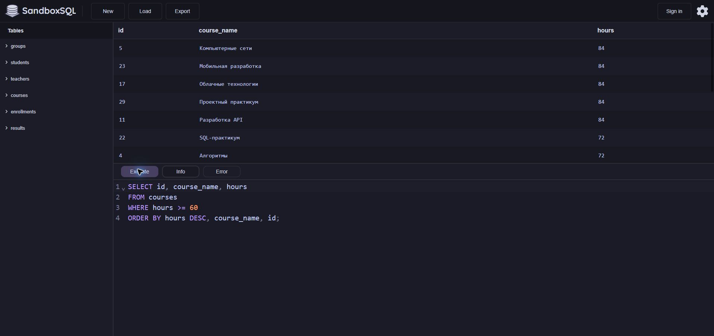

### Первые десять студентов, поступивших в 2025 году

```sql
SELECT id, full_name, admission_year
FROM students
WHERE admission_year = 2025
ORDER BY full_name, id
LIMIT 10;
```

Фильтр по году и сортировка по ФИО дают первые 10 из 60 студентов, поступивших в 2025 году. Ниже показаны первые три строки.

| id | full_name | admission_year |
| --- | --- | --- |
| 136 | Васильев Алина | 2025 |
| 124 | Васильев Анна | 2025 |
| 140 | Васильев Ксения | 2025 |

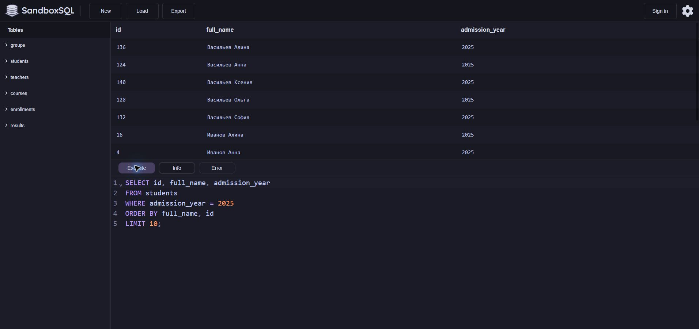

## 4. Агрегатные функции и группировка

### Число записей на курсы

```sql
SELECT COUNT(*) AS enrollment_count FROM enrollments;
```

Подсчитаны все строки `enrollments`. Это 1000 записей на курсы с любыми статусами.

| enrollment_count |
| --- |
| 1000 |

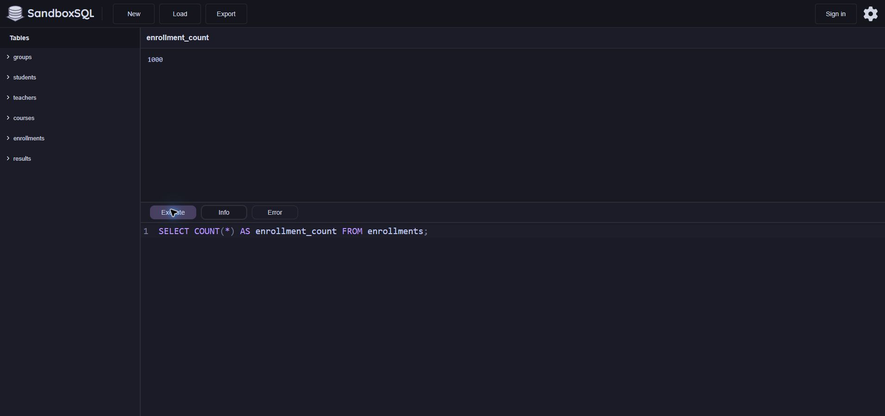

### Минимум, максимум, среднее и сумма часов

```sql
SELECT MIN(hours) AS min_hours, MAX(hours) AS max_hours,
       AVG(hours) AS avg_hours, SUM(hours) AS total_hours
FROM courses;
```

Четыре агрегатные функции вычисляют минимум, максимум, среднее и сумму по столбцу `hours`.

| min_hours | max_hours | avg_hours | total_hours |
| --- | --- | --- | --- |
| 24 | 84 | 54.0 | 1620 |

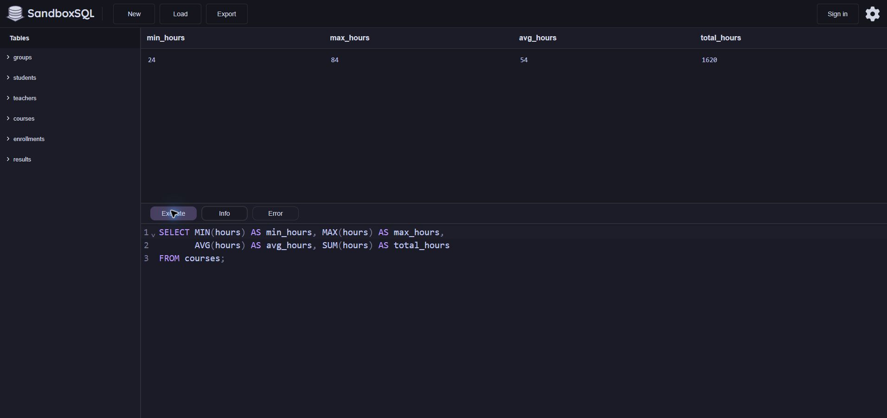

Продолжительность курса составляет от 24 до 84 часов. Среднее значение равно 54 часам, сумма по всем курсам — 1620 часов.

### Число записей по статусам

```sql
SELECT status, COUNT(*) AS enrollment_count
FROM enrollments
GROUP BY status
ORDER BY enrollment_count DESC, status;
```

Группировка по `status` даёт три строки. Их количества в сумме составляют 1000 записей.

| status | enrollment_count |
| --- | --- |
| completed | 850 |
| active | 100 |
| cancelled | 50 |

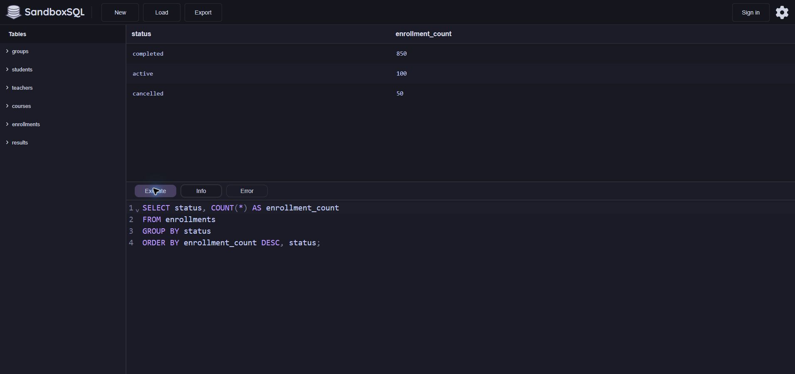

### Статусы с числом записей больше 100

```sql
SELECT status, COUNT(*) AS enrollment_count
FROM enrollments
GROUP BY status
HAVING COUNT(*) > 100
ORDER BY enrollment_count DESC, status;
```

Условие `HAVING` применяется к подсчитанному числу строк в каждой группе.

| status | enrollment_count |
| --- | --- |
| completed | 850 |

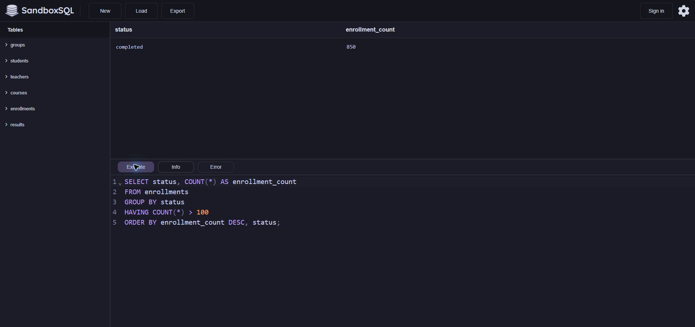

Порог прошёл только статус `completed`. У `active` ровно 100 записей, поэтому этот статус исключён условием `> 100`.

## 5. Соединение таблиц

### Первые десять студентов с группами

```sql
SELECT s.id AS student_id, s.full_name, g.group_name
FROM students AS s
INNER JOIN "groups" AS g ON g.id = s.group_id
ORDER BY s.id
LIMIT 10;
```

Соединение по `group_id` возвращает группу для каждого совпавшего студента. Из первых десяти строк ниже показаны три.

| student_id | full_name | group_name |
| --- | --- | --- |
| 1 | Иванов Александр | ИВТ-01 |
| 2 | Иванов Мария | ИВТ-02 |
| 3 | Иванов Иван | ИВТ-03 |

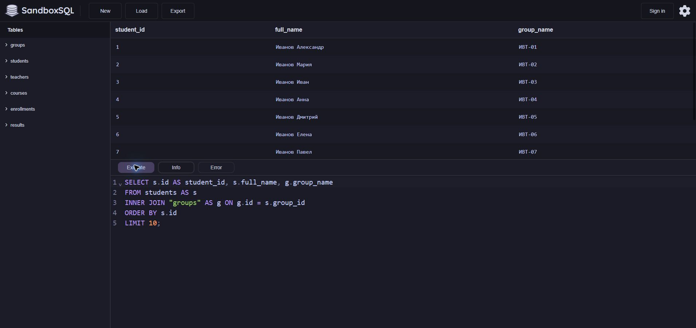

### Первые десять курсов с преподавателями

```sql
SELECT c.id AS course_id, c.course_name, t.full_name AS teacher_name
FROM courses AS c
INNER JOIN teachers AS t ON t.id = c.teacher_id
ORDER BY c.id
LIMIT 10;
```

Соединение по `teacher_id` возвращает имя преподавателя курса. Из первых десяти строк ниже показаны три.

| course_id | course_name | teacher_name |
| --- | --- | --- |
| 1 | Основы программирования | Преподаватель 01 |
| 2 | Базы данных | Преподаватель 02 |
| 3 | Веб-разработка | Преподаватель 03 |

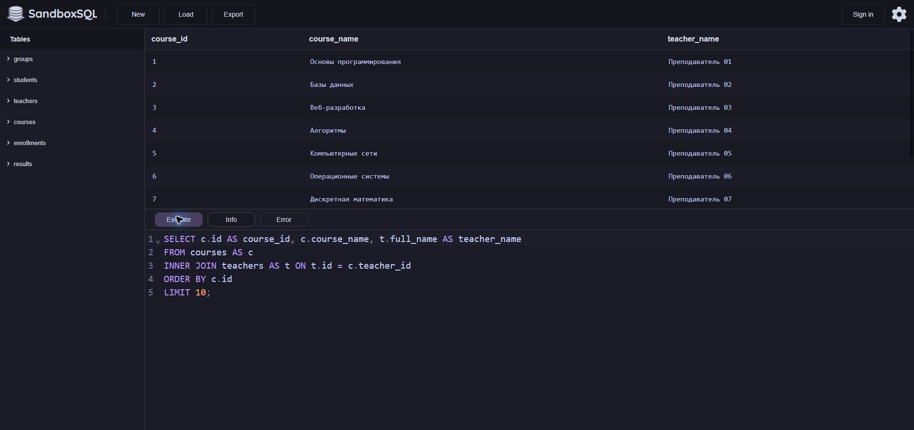

### Все преподаватели и закреплённые за ними курсы

```sql
SELECT t.id AS teacher_id, t.full_name AS teacher_name,
       c.id AS course_id, c.course_name
FROM teachers AS t
LEFT JOIN courses AS c ON c.teacher_id = t.id
ORDER BY t.id, c.id;
```

Левое соединение сохраняет преподавателей даже при отсутствии курса. Ниже показаны первые три из 30 строк.

| teacher_id | teacher_name | course_id | course_name |
| --- | --- | --- | --- |
| 1 | Преподаватель 01 | 1 | Основы программирования |
| 1 | Преподаватель 01 | 16 | Инженерия требований |
| 2 | Преподаватель 02 | 2 | Базы данных |

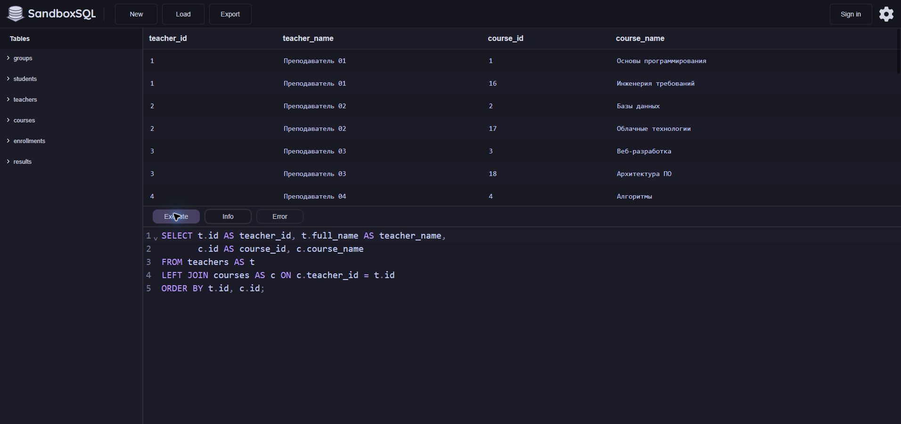

В первых двух запросах `INNER JOIN` возвращает только строки с совпавшими ключами. Третий запрос сохраняет всех преподавателей. Получено 30 строк для 15 преподавателей, у каждого по два курса.

## 6. Проверка качества данных

### Число недопустимых или пустых баллов

```sql
SELECT COUNT(*) AS invalid_scores
FROM results
WHERE score < 0 OR score > 100 OR score IS NULL;
```

Условия объединены через `OR`, поэтому в подсчёт попадают пустые баллы и значения за пределами диапазона.

| invalid_scores |
| --- |
| 0 |

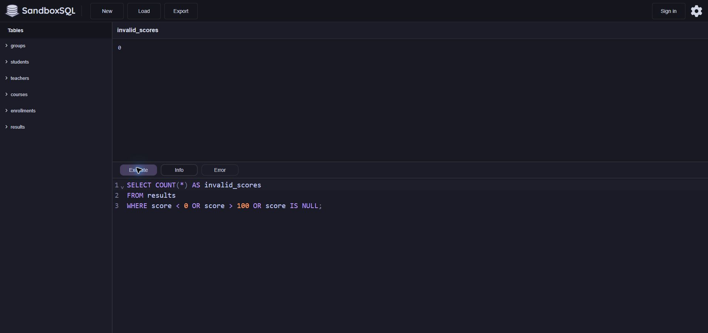

### Число результатов без соответствующей записи на курс

```sql
SELECT COUNT(*) AS orphan_results
FROM results AS r
LEFT JOIN enrollments AS e ON e.id = r.enrollment_id
WHERE e.id IS NULL;
```

Если для результата нет совпавшей записи, поля присоединённой таблицы имеют значение `NULL`. Подсчитываются такие строки.

| orphan_results |
| --- |
| 0 |

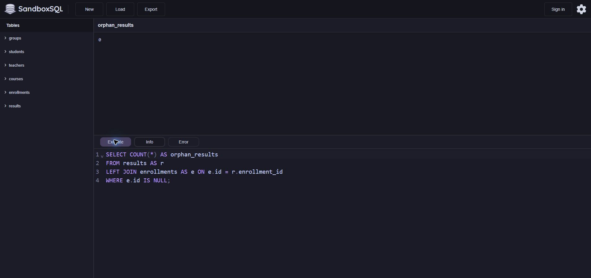

Обе проверки вернули 0. Все баллы заполнены и находятся в диапазоне от 0 до 100. Для каждого результата найдена запись на курс.

## 7. Индивидуальное задание

**Вопрос:** На какие курсы никто не записывался? Кто назначен их преподавателями?

Основной запрос через `NOT EXISTS` проверяет отсутствие строк в `enrollments` для каждого курса. `LEFT JOIN` добавляет имя преподавателя и сохраняет курс, даже если имя по ключу найти не удастся.

### Курсы без записей и их преподаватели

```sql
SELECT c.id AS course_id, c.course_name,
       c.teacher_id, t.full_name AS teacher_name
FROM courses AS c
LEFT JOIN teachers AS t ON t.id = c.teacher_id
WHERE NOT EXISTS (
    SELECT 1 FROM enrollments AS e WHERE e.course_id = c.id
)
ORDER BY c.course_name, c.id;
```

В выдаче два курса. Для каждого по ключу найден преподаватель.

| course_id | course_name | teacher_id | teacher_name |
| --- | --- | --- | --- |
| 30 | Интеграция систем | 15 | Преподаватель 15 |
| 29 | Проектный практикум | 14 | Преподаватель 14 |

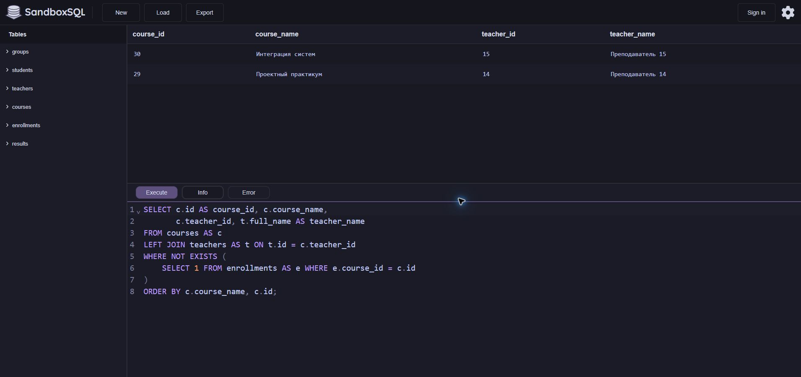

Для проверки записи присоединены через `LEFT JOIN`. Выражение `COUNT(e.id)` считает только совпавшие записи, а `HAVING` оставляет курсы с нулевым числом записей.

### Проверка числа записей по курсам

```sql
SELECT c.id AS course_id, c.course_name,
       c.teacher_id, t.full_name AS teacher_name,
       COUNT(e.id) AS enrollment_count
FROM courses AS c
LEFT JOIN teachers AS t ON t.id = c.teacher_id
LEFT JOIN enrollments AS e ON e.course_id = c.id
GROUP BY c.id, c.course_name, c.teacher_id, t.full_name
HAVING COUNT(e.id) = 0
ORDER BY c.course_name, c.id;
```

В обоих рядах число записей равно нулю. Курсы и преподаватели совпадают с основной выборкой.

| course_id | course_name | teacher_id | teacher_name | enrollment_count |
| --- | --- | --- | --- | --- |
| 30 | Интеграция систем | 15 | Преподаватель 15 | 0 |
| 29 | Проектный практикум | 14 | Преподаватель 14 | 0 |

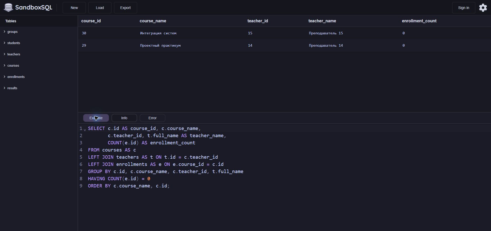

1. Из 30 курсов два остались без записей. Это «Интеграция систем» и «Проектный практикум».
2. У обоих курсов назначены преподаватели. За «Интеграцию систем» отвечает Преподаватель 15, за «Проектный практикум» — Преподаватель 14.
3. Оба запроса вернули одни и те же курсы и преподавателей. Проверочный запрос показал 0 записей для каждого курса.

Запросы учитывают записи с любым статусом и отражают только состояние этой копии базы. По ней нельзя установить, почему на эти курсы никто не записался.

## Вывод

В ходе работы изучена структура базы данных и проверены связи между таблицами. Для отбора строк использованы фильтры и сортировка, для подсчётов — агрегатные функции, для получения связанных данных — соединения. По индивидуальному варианту найдены два курса без записей, результат подтверждён двумя запросами.

