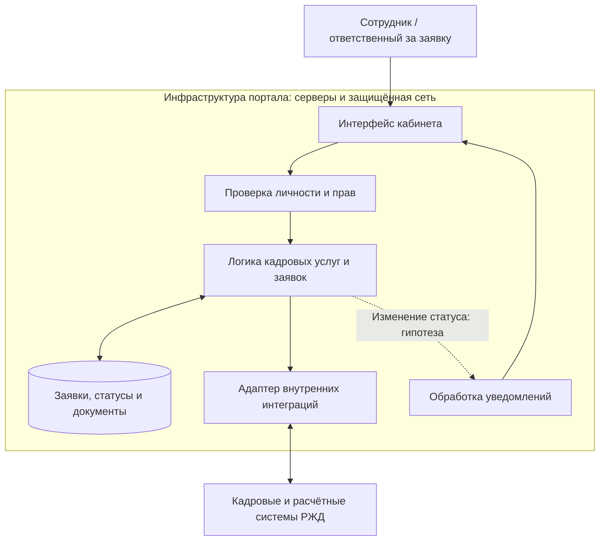
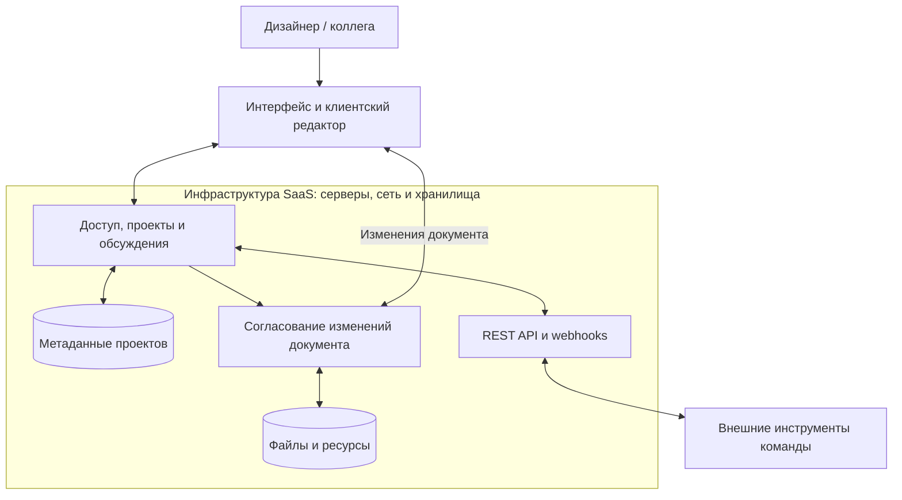
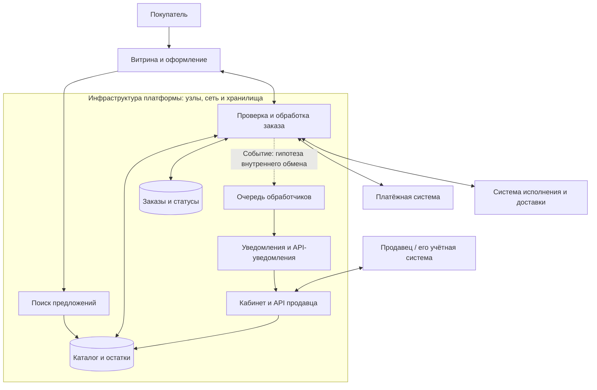

# Сравнительный анализ архитектуры цифровых систем

**Лабораторная работа №5. Вариант 7.**
**Дата исследования:** 23 ноября 2026 года.

Цель работы — сравнить три класса цифровых систем и объяснить, как назначение, пользователи и характер нагрузки влияют на архитектуру.

В отчёте используются три обозначения:

- **Подтверждено источником** — функция или техническое решение описаны владельцем продукта либо его разработчиком. Учитывается дата публикации.
- **Наблюдение** — непосредственно проверенное поведение интерфейса. В этой работе пользовательские операции в исследуемых продуктах не выполнялись; описания функций основаны на открытых материалах.
- **Учебная гипотеза** — предложенные границы компонентов, путь запроса или меры надёжности. Они не выдаются за внутреннюю документацию компании.

## 1. Выбранные цифровые продукты

Вариант 7 включает корпоративный портал предприятия, Figma и Яндекс Маркет. Для первого пункта выбран конкретный закрытый портал РЖД: задание разрешает изучать его по общедоступному описанию.

| Продукт и адрес | Класс и границы исследования | Основные источники |
|---|---|---|
| [Сервисный портал работника РЖД](https://my.rzd.ru/) | Корпоративный портал: внутренние услуги сотрудникам одного холдинга. Не сайт продажи билетов | [Описание функций][rzd-functions], [интервью разработчика][rzd-tech] |
| [Figma](https://www.figma.com/) | SaaS: рассматривается Figma Design — облачная среда проектирования интерфейсов для разных команд | [Возможности][figma-features], [прототипирование][figma-prototype], [совместное редактирование][figma-multi], [REST API][figma-api] |
| [Яндекс Маркет](https://market.yandex.ru/) | Маркетплейс: предложения независимых продавцов, покупатели и организация исполнения заказов | [API продавца][market-api], [уведомления][market-events], [оплата][market-payment], [доставка][market-delivery] |

Классы определены по назначению, а не по внешнему виду страниц. Портал РЖД обслуживает трудовые процессы внутри предприятия. Figma предоставляет программный инструмент клиентским командам. Маркет связывает покупателей с продавцами. Возможность работы через браузер есть у всех трёх, но сама по себе не делает их одним классом.

## 2. Назначение, пользователи и функции

### 2.1. Сервисный портал работника РЖД

**Назначение:** предоставить сотруднику доступ к кадровым и социальным услугам компании. В публикации «РЖД Цифровой» описаны работники, руководители и взаимодействие с кадровой службой. Это основные категории участников; конкретные роли доступа закрытого портала не исследовались. [Источник][rzd-functions].

**Функции по открытому описанию:**

1. Заказ справок.
2. Оформление кадровых документов и отпуска.
3. Получение сведений о доходе.
4. Заявки на льготы и компенсации.
5. Доступ к обучению и карьерным возможностям.
6. Корпоративные новости и коммуникации.

**Сценарий из пяти действий (учебная реконструкция):** сотрудник входит → выбирает заказ справки → указывает необходимые сведения → отправляет заявку → получает результат после обработки. Названия конкретных кнопок и способ выдачи документа не утверждаются: доступа в закрытый кабинет нет.

### 2.2. Figma Design

**Назначение:** проектирование интерфейсов и обсуждение решений в общем рабочем пространстве. **Пользователи:** дизайнеры, разработчики, участники согласования и администраторы команд. Figma относится к SaaS: поставщик обслуживает продукт, а команды используют его возможности по выбранному плану. [Возможности и планы][figma-plans].

**Ключевые функции:**

1. Создание макетов интерфейсов.
2. Повторное использование компонентов и стилей.
3. Совместное редактирование файла.
4. Создание интерактивных прототипов.
5. Обсуждение через комментарии.
6. Передача макета разработчику для реализации.

Функции описаны в материалах о [Figma Design][figma-features], [прототипировании][figma-prototype] и [API][figma-api].

**Сценарий из пяти действий:** дизайнер открывает файл → создаёт экран → связывает его с другим экраном в прототипе → предоставляет коллеге доступ → коллега просматривает прототип и оставляет комментарий. Это типовой сценарий по документации, без создания файла или отправки приглашений в ходе исследования.

### 2.3. Яндекс Маркет

**Назначение:** организовать выбор и покупку товаров у продавцов через общую площадку. **Пользователи:** покупатели, продавцы и их сотрудники; в исполнении участвуют службы доставки и поддержки. Разные предложения и торговые операции объединяются платформой, поэтому это маркетплейс, а не магазин одного продавца. [Документация продавца][market-api], [справка доставки][market-delivery].

**Ключевые функции:**

1. Выбор товара и предложения продавца.
2. Оформление и оплата покупки.
3. Выбор доставки и просмотр состояния заказа.
4. Управление ассортиментом и ценами продавца.
5. Обновление остатков.
6. Обработка заказов и возвратов продавцом.

Функции покупателя описаны в справке об [оплате][market-payment] и [доставке][market-delivery]; операции продавца — в [API][market-api].

**Сценарий из пяти действий:** покупатель выбирает товар → добавляет его в корзину → задаёт получение и доступный способ оплаты → подтверждает заказ → проверяет статус в разделе заказов. Доступность способов оплаты и доставки зависит от условий покупки; реальный заказ не создавался.

## 3. Компоненты и логические схемы

Все три схемы — упрощённые логические модели. Стрелки обозначают направление обращения или передачи данных, двусторонняя стрелка — обмен. Пунктир показывает предлагаемый асинхронный поток. Блоки не означают отдельные физические серверы. В каждой модели интерфейс, логика и данные работают на инфраструктуре; внешние системы вынесены за её границу.

### 3.1. Портал РЖД

| Группа | Назначение в модели |
|---|---|
| Интерфейс | Кабинет сотрудника и формы обращений; рабочее представление ответственного за обработку — предположение |
| Прикладная логика | Проверка прав, регистрация заявки, правила кадровых услуг, контроль состояния исполнения |
| Данные | Заявки и их статусы, документы, сведения о сотруднике с ограничением доступа |
| Интеграции | Связь с кадровыми и расчётными системами; конкретные протоколы и продукты не установлены |
| Инфраструктура | Серверы и сеть портала; разработчик подтверждает фильтрацию входящего трафика и закрытый контур чувствительных данных. Реплики, очереди и мониторинг ниже рассматриваются как необходимые проектные меры, а не установленный состав |

**Путь запроса (гипотеза):** форма передаёт заявку; сервер проверяет доступ сотрудника к выбранной услуге, сохраняет номер и начальное состояние, передаёт нужные сведения внутренней системе. Результат обработки меняет статус и становится доступен в кабинете. Если внутренняя система временно недоступна, зарегистрированную заявку целесообразно сохранить для повторной обработки, а не сообщать о её завершении.

**Граница фактов:** функции подтверждены [описанием портала][rzd-functions], микросервисный подход и защита данных — [разработчиком][rzd-tech]. Разбиение на показанные блоки и последовательность обработки предложены для учебной модели.

### 3.2. Figma Design

| Группа | Назначение в модели |
|---|---|
| Интерфейс | Редактор, холст, просмотр прототипа и комментарии; часть операций редактирования исполняется на клиенте |
| Прикладная логика | Проверка доступа, работа с проектами, согласование изменений общего документа |
| Данные | Содержимое файлов и ресурсы; отдельно — сведения о проектах, пользователях и обсуждениях |
| Интеграции | Документированный REST API и webhooks для внешних инструментов |
| Инфраструктура | Серверы приложений и совместного редактирования, сеть и хранилища; конкретное размещение и количество узлов не установлены |

**Путь запроса:** для изменения макета клиент сначала получает файл и доступ к нему, затем передаёт изменения общему серверному компоненту; другие подключённые редакторы получают обновления. Общее направление этого обмена через WebSocket описано Figma в 2019 году. Размещение проверки доступа и хранилищ на схеме — учебное упрощение, а не точная современная топология. [Техническая публикация][figma-multi].

Комментарий из сценария относится к обсуждению файла; он не обязан идти по тому же каналу, что движение объектов на холсте. Подтверждённый внешний REST API не следует путать с внутренним протоколом редактора.

### 3.3. Яндекс Маркет

| Группа | Назначение в модели |
|---|---|
| Интерфейс | Витрина покупателя, корзина, оформление, список заказов, кабинет продавца |
| Прикладная логика | Поиск предложений, правила заказа, проверка цены и остатка, управление состоянием исполнения |
| Данные | Каталог, предложения, остатки, заказы и история изменения статусов |
| Интеграции | API продавца, системы оплаты и доставки; уведомления о событиях заказов |
| Инфраструктура | Для модели нужны балансировка, вычислительные узлы, хранилища и наблюдаемость. Брокер и поисковый индекс — предложенные элементы; их фактические технологии не установлены |

**Путь запроса (гипотеза):** витрина обращается к поиску, после выбора оформление передаёт состав покупки логике заказа. Перед подтверждением следует проверить актуальные цену и остаток; результат оплаты и состояние заказа сохраняются. Затем можно уведомить продавца и покупателя. Конкретная последовательность резервирования, оплаты и передачи в доставку зависит от модели продажи и здесь не утверждается.

Справка подтверждает покупательские операции, а API — обмен с продавцом. Наличие внешних [API-уведомлений][market-events] не доказывает существование конкретного внутреннего брокера. Пунктирный поток на схеме является гипотезой.

## 4. Анализ архитектурных подходов

### 4.1. Портал РЖД: микросервисная архитектура

**Основание:** в интервью от 5 сентября 2025 года руководитель компании-разработчика прямо называет микросервисную архитектуру. Это опубликованное сведение об этапе развития портала, а не вывод по его внешнему виду. Текущие границы сервисов неизвестны. [Источник][rzd-tech].

**Почему подход обоснован — собственные аргументы:**

1. У разных услуг различается нагрузка: массовое чтение сведений и обработка отдельного кадрового документа требуют разных ресурсов. Раздельное масштабирование позволяет не увеличивать всю систему ради одной функции.
2. Интеграции с внутренними системами могут обновляться независимо. Границы сервисов позволяют локализовать адаптеры и ограничить влияние их изменений.
3. При большом числе функциональных областей независимые выпуски полезны, если команды соблюдают согласованные контракты.

**Недостаток:** сквозная заявка пересекает несколько компонентов. Сложнее отследить причину задержки и не допустить повторного исполнения при повторе запроса.

**События (гипотеза):** изменение статуса заявки может запускать уведомление асинхронно. Нужны идентификатор операции, контроль повторов и возможность восстановить обработку.

Модульный монолит из лекции — разумная исходная модель небольшого портала, но класс системы не предписывает её крупному предприятию.

### 4.2. Figma: разделение обычных операций и совместного редактирования

**Подтверждено:** публикация Figma от 16 октября 2019 года описывает клиент-серверную синхронизацию документов по WebSocket и отдельную работу с метаданными. Это историческое описание; оно не доказывает устройство всей платформы в 2026 году. [Источник][figma-multi].

**Учебная гипотеза:** модульное серверное ядро для проектов и доступа, дополненное отдельным масштабируемым компонентом совместного редактирования. Устройство всего продукта как «чистых микросервисов» по выбранным источникам не установлено.

**Аргументы:**

1. Редактирование требует непрерывного обмена небольшими изменениями и низкой задержки. Выделение этого пути уменьшает его зависимость от фоновых и административных операций.
2. Проекты, доступ и обсуждения имеют другую частоту и характер запросов. Их можно развивать как модули без отдельного сервиса для каждой функции.
3. Документы разных команд можно распределять по узлам, но популярный файл всё равно требует согласованного состояния всех участников.

**Недостаток:** появляется граница между состоянием документа и общими данными. Переподключение, отзыв доступа и сбой сохранения должны обрабатываться согласованно.

**Событийное взаимодействие:** внешние webhooks документированы [Figma][figma-api]. Использование внутренней очереди для фоновых действий допустимо как гипотеза. Сам по себе WebSocket — транспорт обмена, а не доказательство событийной архитектуры всего продукта.

### 4.3. Яндекс Маркет: независимые сервисы и события как проектная гипотеза

**Подтверждено:** API поддерживает работу продавца с товарами, остатками и заказами. Уведомления сообщают об изменениях. Эти сведения описывают внешний контракт, а не внутреннее развёртывание. [API][market-api], [события][market-events].

**Учебная гипотеза:** для платформы такого класса целесообразно выделять независимо развёртываемые сервисы поиска, предложений и заказов, дополняя их событийной обработкой уведомлений. Это не утверждение о полной реальной архитектуре Маркета.

**Аргументы:**

1. Просмотр предложений и подтверждение заказа имеют разный профиль нагрузки. Поиск можно масштабировать отдельно от критической записи заказа.
2. Обновления продавцов поступают независимо от действий покупателей; отдельный интеграционный контур позволяет сглаживать пики и ограничивать нагрузку.
3. У одного изменения статуса может быть несколько получателей. Асинхронный обмен уменьшает число синхронных зависимостей оформления.

**Недостаток:** распределённые остатки, оплата и заказ требуют защиты от расхождений и повторного выполнения. Ошибка между шагами должна приводить к явному состоянию и восстановлению, а не к незаметной потере заказа.

## 5. Сравнение нефункциональных характеристик

Таблица содержит качественные оценки предложенных моделей. Замеры нагрузки, показатели доступности и внутренние SLA компаний не получены. «Независимое масштабирование» — возможность подхода при корректной реализации, а не гарантия.

| Критерий | Портал РЖД | Figma Design | Яндекс Маркет |
|---|---|---|---|
| Класс | Корпоративный портал | SaaS для проектирования | Маркетплейс |
| Ключевые функции | Кадровые услуги, справки, сведения сотрудника | Макеты, компоненты, прототипы, обсуждение | Выбор товара, покупка, операции продавца |
| Основные компоненты модели | Кабинет, услуги, заявки, адаптер внутренних систем | Клиентский редактор, доступ и проекты, синхронизация, хранилища | Витрина, поиск, заказ, данные предложений, внешние интеграции |
| Архитектура и основание | Микросервисы названы разработчиком в 2025 году; границы на схеме условны | Отдельный путь совместного редактирования подтверждён исторической публикацией; модульное ядро — гипотеза | Сервисы с событиями — целесообразная модель; API не раскрывает внутреннюю топологию |
| Масштабируемость | В модели услуги масштабируются по своей нагрузке. Ограничением могут стать общая авторизация и скорость внутренних систем | Разные документы можно распределять между узлами. Один большой совместный файл и длительные подключения требуют отдельного контроля ресурсов | Чтение каталога и поиск масштабируются отдельно; подтверждение заказа ограничено конкуренцией за актуальные остатки |
| Отказоустойчивость | Сбой одной услуги не должен блокировать остальные. Нужны тайм-ауты интеграций, сохранение заявок и безопасные повторы; общий вход остаётся критической зависимостью | Сбой синхронизации нарушает совместную работу. Нужны восстановление сессии, сохранность изменений и проверка прав после переподключения | При сбое оплаты нельзя показывать успешную покупку без подтверждения. Нужны устойчивые статусы, идемпотентная обработка и восстановление незавершённых операций |
| Сложность сопровождения | Высокая из-за числа контрактов и связи с кадровыми системами; нужны сквозной идентификатор заявки и интеграционные проверки | Высокая из-за согласования клиентского и серверного состояния; нужны проверки параллельных правок и разрывов соединения | Высокая из-за цепочки заказа и внешних участников; нужны версионирование API, мониторинг очередей и диагностика сквозной операции |

Для всех систем резервные копии нужны для восстановления после потери данных, а реплики и резервные узлы — для продолжения работы при части отказов. Одно не заменяет другое. Разбиение на сервисы не устраняет общие точки отказа автоматически.

## 6. Проверка обоснованности и компромиссы

| Система | Главный компромисс | Следствие для модели |
|---|---|---|
| Портал РЖД | Независимое развитие услуг против сложности связи с внутренними системами | Заявка должна иметь единый прослеживаемый номер, даже если проходит несколько компонентов |
| Figma | Быстрый локальный отклик редактора против сложности согласования общей версии | Требуется корректно соединять локальные правки и серверное состояние, особенно после обрыва связи |
| Яндекс Маркет | Отдельное масштабирование поиска и фоновых процессов против немедленной согласованности данных | Результат поиска не заменяет проверку условий при оформлении; события могут приходить позже и повторяться |

**Условие пересмотра решения:** в предложенной модели Figma серверное ядро стоит разделять дальше, если фоновые операции проектов регулярно ухудшают задержку редактирования, а независимые команды вынуждены ждать общего выпуска. Сначала нужны измерения задержек, профили ресурсов и анализ зависимостей. Выделять следует конкретный мешающий модуль, а не автоматически каждую таблицу. Это условие развития учебной модели, не рекомендация по неизвестному текущему коду Figma.

**Проверка согласованности:**

- Выбраны три разных класса по назначению и составу участников.
- У каждой системы есть не менее четырёх функций, несколько категорий пользователей и сценарий из пяти действий.
- В схемах есть пути для описанных сценариев: заявка портала, работа с файлом и обсуждением, оформление заказа.
- Пять групп компонентов описаны для каждой системы. Стрелки показывают обмен, а не выдуманную физическую топологию.
- Для каждого подхода приведены минимум два аргумента и недостаток. Оценки в таблице связаны с конкретными операциями и зависимостями.
- Публичное заявление разработчика РЖД отделено от наших границ сервисов; публикация Figma ограничена её датой; API Маркета не принят за доказательство его внутренней реализации.

## 7. Выводы и ограничения анализа

**Вывод 1.** Главная операция различается: у портала это внутреннее обращение, у Figma — изменение общего документа, у Маркета — покупка у продавца. Поэтому в первом случае особенно важны состояние заявки и доступ сотрудника, во втором — задержка и согласование правок, в третьем — проверка условий и корректность заказа.

**Вывод 2.** Класс системы даёт отправную точку, но не окончательный ответ. Корпоративный портал необязательно является небольшим монолитом: пример РЖД показывает применение микросервисов. Для гипотетического портала с несколькими услугами и маленькой командой такая сложность могла бы быть неоправданной.

**Вывод 3.** Во всех трёх моделях можно масштабировать разные части, но узкие места различны: интеграция с внутренней системой, совместная работа над одним файлом, конкурирующие изменения остатков. Добавление серверов без учёта этих ограничений не гарантирует улучшения.

**Вывод 4.** Асинхронная обработка удобна для уведомлений и фоновых реакций, но не отменяет критические проверки. Нельзя считать заявку исполненной до результата, доступ к файлу разрешённым без проверки, заказ оплаченным без подтверждения. Повторы и задержки должны быть предусмотрены в модели.

**Вывод 5.** Цена независимости — сопровождение контрактов и восстановление сквозных операций. Поэтому выбор между модульным приложением и отдельными сервисами нужно связывать с нагрузкой, командой и стоимостью эксплуатации, а не с престижностью технологии.

**Ограничения:** закрытый портал не обследовался изнутри; производственные системы не тестировались под нагрузкой. Функции взяты из открытых описаний. Технические заявления относятся к датам публикаций, а документация API подтверждает только доступный внешний интерфейс. Схемы, меры отказоустойчивости и сравнение — учебная интерпретация. Отсутствие сведений о конкретном компоненте не означает, что у продукта его нет.

## Источники информации

Все ссылки изучены 23.11.2026. Источники использованы для проверки фактов; формулировки анализа и схемы составлены для этой работы.

1. РЖД Цифровой. [Трансформация HR-Tech][rzd-functions], 15.09.2025 — функции портала и категории участников.
2. РЖД Цифровой. [Создание Сервисного портала: технические вызовы и решения][rzd-tech], 05.09.2025 — интервью руководителя разработчика.
3. Figma. [Design collaboration tools][figma-features] — возможности Figma Design.
4. Figma Learn. [Compare Figma plans and features][figma-plans] — планы и организация продукта.
5. Figma Learn. [Guide to prototyping in Figma][figma-prototype] — прототипы и обсуждение.
6. Evan Wallace, Figma. [How Figma’s multiplayer technology works][figma-multi], 16.10.2019 — историческое описание синхронизации.
7. Figma Developer Docs. [REST API: Introduction][figma-api] — внешние API и webhooks.
8. Яндекс. [API Маркета для продавцов][market-api] — ассортимент, цены, остатки и заказы.
9. Яндекс. [Как работать с уведомлениями][market-events] — события внешней интеграции.
10. Яндекс. [Способы оплаты][market-payment] — покупательские операции.
11. Яндекс. [Доставка][market-delivery] — получение и статус заказа.
12. Учебный курс. [Лекция 5][lecture] и [задание лабораторной №5][assignment] — понятия и этапы анализа.
13. А. Васильев. [Пример отчёта][example] — ориентир структуры; исследуемые продукты и выводы в настоящей работе другие.

[rzd-functions]: https://rzddigital.ru/projects/transformatsiya-hr-tech/
[rzd-tech]: https://rzddigital.ru/opinions/sozdanie-servisnogo-portala-tekhnicheskie-vyzovy-i-resheniya/
[figma-features]: https://www.figma.com/resource-library/design-collaboration-tools/
[figma-plans]: https://help.figma.com/hc/en-us/articles/360040328273-Compare-Figma-plans-and-features
[figma-prototype]: https://help.figma.com/hc/en-us/articles/360040314193-Guide-to-prototyping-in-Figma
[figma-multi]: https://www.figma.com/blog/how-figmas-multiplayer-technology-works/
[figma-api]: https://developers.figma.com/docs/rest-api/
[market-api]: https://yandex.ru/dev/market/partner-api/doc/ru/
[market-events]: https://yandex.ru/dev/market/partner-api/doc/ru/push-notifications/
[market-payment]: https://yandex.ru/support/market/ru/order/payment
[market-delivery]: https://www.yandex.ru/support/market/ru/order/delivery?lang=ru
[lecture]: https://ninety-elfish-ipod.tilda.ws/members/courses/course834633657952/klassy-vebsistem-i-arhitekturnye-podhody-701121779149
[assignment]: https://ninety-elfish-ipod.tilda.ws/members/courses/course834633657952/laboratornaa-5-399928193317
[example]: https://github.com/vasilevIT/computer-science/blob/main/lab5/report/analysis.md
