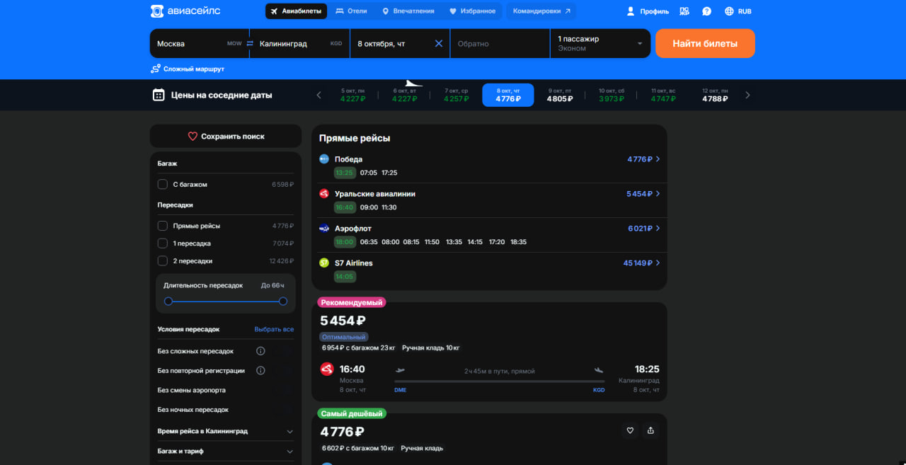
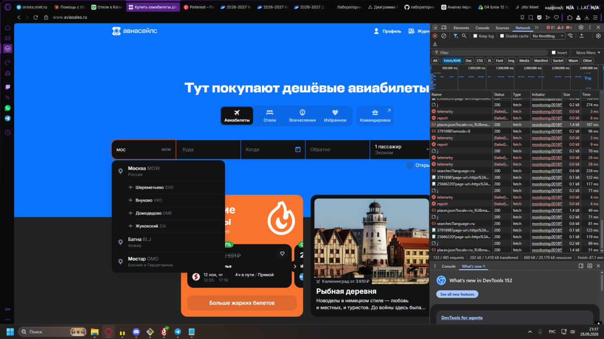
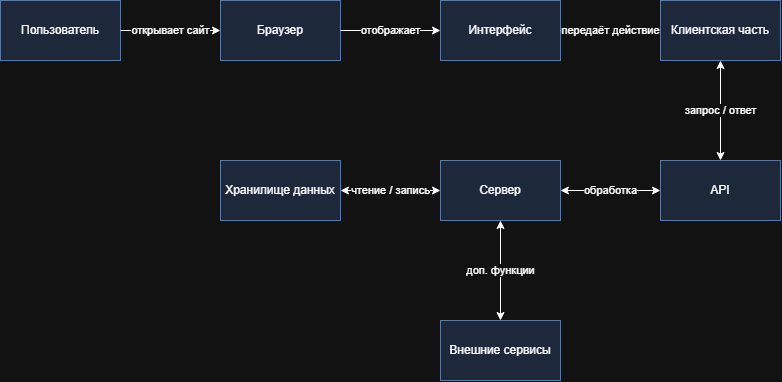

# Отчёт по лабораторной работе №1

**Тема:** Анализ устройства современной информационной системы

**Вариант:** 7, сервис Aviasales

**Сценарий:** поиск билетов по маршруту

## 1. Описание цифрового сервиса

**Название:** Aviasales

**Ссылка:** https://www.aviasales.ru/

**Назначение:** сервис поиска и сравнения авиабилетов разных авиакомпаний и агентств. Пользователь вводит маршрут и дату, а система показывает доступные предложения с ценами.

**Целевая аудитория:** путешественники, туристы, люди в командировках.

**Основные возможности:**

- поиск билетов по маршруту и датам;
- сравнение цен и предложений;
- фильтры (цена, пересадки, время вылета);
- переход к оформлению билета у продавца.

**Выбранный сценарий:** поиск билетов по маршруту Москва — Калининград. Покупка не выполнялась.

## 2. Анализ компонентов системы

### 2.1. Пользовательский интерфейс

| Элемент интерфейса | Где находится | Для чего нужен |
|---|---|---|
| Поле «Откуда» | Форма поиска на главной | Выбор города вылета |
| Поле «Куда» | Форма поиска на главной | Выбор города прилёта |
| Календарь дат | Форма поиска | Выбор даты вылета |
| Кнопка «Найти билеты» | Форма поиска | Запуск поиска |
| Фильтры | Страница результатов | Уточнение выдачи по цене, пересадкам, времени |
| Карточка билета | Список результатов | Показывает цену, время, авиакомпанию, пересадки |

В сценарии участвуют форма поиска (ввод данных), подсказки городов, календарь, список результатов с карточками и фильтры.


*Рис. 1. Главная страница с формой поиска*



*Рис. 2. Страница результатов поиска*

### 2.2. Серверная часть и API

Сервер напрямую не виден, поэтому выводы ниже сделаны как предположения на основе запросов в разделе Network.

| Компонент | Что делает | Какие данные | Основание |
|---|---|---|---|
| Сервер приложения | Принимает параметры поиска и возвращает список билетов | Маршрут, даты, число пассажиров | Запрос отправляется при нажатии «Найти билеты» |
| API | Точка обмена данными между браузером и сервером | Параметры запроса, ответ в формате JSON | Запросы в фильтре Fetch/XHR |
| Хранилище данных (предположительно) | Хранит справочник городов и аэропортов, кэш цен | Названия городов, коды аэропортов, цены | Подсказки городов появляются сразу при вводе |
| Внешние сервисы | Предложения авиакомпаний и агентств, аналитика, реклама | Данные о билетах, статистика действий | Запросы к сторонним доменам (колонка Domain) |

Домены, к которым обращается страница во время сценария:

| Домен | Назначение (предположительно) |
|---|---|
| `suggest.aviasales.com` | Подсказки городов и аэропортов |
| `tickets-api.aviasales.ru` | Поиск билетов и цены |
| `search-history-api.aviasales.com` | История поисков пользователя |
| `sentry-relay.avs.io` | Сбор ошибок (сервис Sentry) |
| `awswaf.com` | Защита от ботов (Amazon AWS WAF) |
| `widget-api.uxfeedback.ru` | Опросы и отзывы пользователей |

## 3. Результаты исследования DevTools

### 3.1. HTML-структура (вкладка Elements)

Форма поиска состоит из элементов `<input>` для ввода городов и даты и `<button>` для запуска поиска. Например, поле «Откуда» имеет вид `<input id="avia_form_origin-input" placeholder="Откуда" data-test-id="origin-input">` с CSS-классами `s__nwPpMAyTVCIBOgMC` и `s__e55WavZ16ZkC4oaZ`. Такие имена классов генерируются автоматически, поэтому выглядят как набор случайных символов.


*Рис. 3. Элемент интерфейса в панели Elements*

### 3.2. Ресурсы страницы

При открытии страницы браузер загружает:

- HTML-документ;
- CSS-файлы со стилями: 18;
- JavaScript-файлы: 147;
- изображения, иконки и шрифты (логотипы авиакомпаний, значки интерфейса).

### 3.3. Сетевые запросы (вкладка Network)

При выполнении сценария браузер отправляет запросы к серверу. Основные из них:

| № | URL запроса | Метод | Статус | Что передаётся | Зачем |
|---|---|---|---|---|---|
| 1 | `https://suggest.aviasales.com/v2/places.json?locale=ru_RU&max=7&term=мос&types[]=city&types[]=airport` | GET | 200 | Введённые буквы названия города | Показать варианты городов |
| 2 | `https://tickets-api.aviasales.ru/search/v2/start` | POST | 200 | Города, дата, число пассажиров, класс | Запустить поиск билетов |
| 3 | `https://tickets-api.eu-north-1.aviasales.ru/search/v3.2/results` | POST | 200 | Номер начатого поиска | Получить список билетов |
| 4 | `https://tickets-api.aviasales.ru/search/prices/ribbon?origin=MOW&destination=KGD&currency=RUB&trip_class=Y&passengers_adults=1&is_one_way=true&depart_date_min=2026-11-01&depart_date_max=2026-11-30` | GET | 200 | Маршрут и диапазон дат | Показать цены на соседние даты |

Запрос №3 браузер отправляет несколько раз подряд (в нашем случае 6–7 раз за один поиск): сервер собирает предложения от разных авиакомпаний и агентств постепенно, поэтому билеты появляются на странице не сразу, а порциями.

**Параметры запроса подсказок (№1):**

| Параметр | Значение | Смысл |
|---|---|---|
| `locale` | `ru_RU` | Язык ответа |
| `max` | `7` | Максимум вариантов в списке |
| `term` | `мос` | Что ввёл пользователь (в адресе кодируется как `%D0%BC%D0%BE%D1%81`) |
| `types[]` | `city`, `airport` | Искать среди городов и аэропортов |

Фрагмент ответа сервера (формат JSON):

```json
[
  {
    "type": "city",
    "code": "MOW",
    "name": "Москва",
    "country_name": "Россия",
    "coordinates": { "lon": 37.617633, "lat": 55.755786 }
  },
  {
    "type": "airport",
    "code": "SVO",
    "name": "Шереметьево",
    "city_name": "Москва"
  }
]
```

Данные между клиентом и сервером передаются в формате JSON. Ответ на запрос поиска содержит список предложений с ценами и параметрами перелёта.



*Рис. 4. Запросы в панели Network*

## 4. Описание пользовательского сценария

1. Пользователь вводит города и дату и нажимает «Найти билеты».
2. Интерфейс принимает данные формы и показывает индикатор загрузки.
3. Клиентская часть формирует запрос к API с параметрами маршрута (`search/v2/start`).
4. Сервер обрабатывает запрос и собирает предложения от авиакомпаний и агентств.
5. Список билетов возвращается в браузер в виде данных (`search/v3.2/results`).
6. Интерфейс отображает результаты с ценами и фильтрами.

## 5. Архитектурная схема



*Рис. 5. Архитектура сервиса Aviasales*

Исходный файл схемы: [system_architecture.drawio](../diagrams/system_architecture.drawio)

Схема показывает путь запроса: пользователь работает через браузер и интерфейс, клиентская часть отправляет запрос в API, сервер обрабатывает его, обращается к хранилищу данных и внешним сервисам, после чего ответ возвращается обратно к пользователю.

## 6. Вывод

В ходе работы был проанализирован сервис Aviasales на примере сценария поиска билетов по маршруту. Выделены основные компоненты: интерфейс, клиентская часть, API, сервер, хранилище данных и внешние сервисы. С помощью DevTools изучены запросы, которые браузер отправляет при поиске. Работа помогла понять, как устроена современная информационная система и как взаимодействуют её части.
